# Scenario Concerns and Proposed Treatment Diagram

**Scenario view only:** qualitative concerns and proposed treatments, not verified control failures, conformity or achieved risk reduction. See the [assurance matrix](../controls-checklist/controls.md).

```mermaid
flowchart TD
    A[Botium Toys Security Posture] --> B[Access Control Failures]
    A --> C[Data Protection Failures]
    A --> D[Incident Response Gaps]
    A --> E[Network Security Gaps]
    A --> F[Applicability and Assurance Gaps]

    B --> B1[No Least Privilege]
    B --> B2[No Password Policies]
    B --> B3[No Password Manager]

    C --> C1[No Encryption]
    C --> C2[Payment Protection Concerns]

    D --> D1[No Disaster Recovery Plan]
    D --> D2[No GDPR Breach Notification Plan]

    E --> E1[No IDS]
    E --> E2[Legacy Systems Manual Monitoring]

    F --> F1[Payment Scope Review]
    F --> F2[Privacy Scope Review]
    F --> F3[Assurance Review]

    %% Remediation
    B --> R1[Implement RBAC + PoLP]
    C --> R2[Encrypt Data at Rest & Transit]
    D --> R3[Create & Test DRP]
    E --> R4[Deploy IDS + Centralized Logging]
    F --> R5[Compliance Program Overhaul]
```

